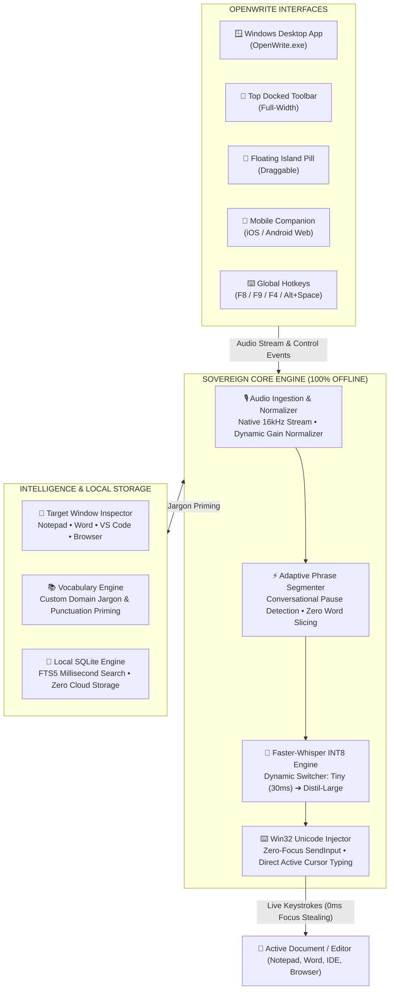

# OpenWrite — Sovereign AI Voice & Dictation Engine 🎙️⚡

> **The Sovereign, 100% Offline AI Dictation Engine.** Real-time streaming speech-to-text directly into any Windows application with zero cloud latency and complete privacy.

---

## 🌟 Highlights

- **100% Offline & Private:** Zero cloud dependencies, zero telemetry, zero audio leaks. All speech-to-text inference runs entirely on your local machine.
- **Runs Smoothly on ANY PC:** Quantized with **INT8 Faster-Whisper** execution on CPU/iGPU/APU. No NVIDIA discrete GPU required. Runs at **~80ms latency** taking less than 100MB of RAM.
- **Global Hotkey & Direct Cursor Injection:** Press `F8`, `Fn+F8`, `F9`, `F4`, or `Alt + Space` anywhere on Windows (Notepad, Word, VS Code, Slack, Chrome) to speak and have words typed live directly into your active window.
- **Dual UI Layout:** Toggle seamlessly between an edge-docked top toolbar (`📌 Dock`) and a draggable floating island pill (`🫧 Float`).
- **Dynamic Model Switcher:** Switch between `Tiny.en` (30ms), `Base.en` (50ms), `Small.en` (Default), `Medium.en`, and `Distil-Large-v3` on the fly.
- **Synthesized Shortcut Engine:** Full support for **Hybrid Mode** (Hold = Push-to-Talk, Quick Tap = Toggle Mode), **Push-to-Talk Only**, and **Toggle Only**.
- **Voice Edit / Rewrite Mode:** Highlight any text in your editor, hold hotkey, speak an edit instruction (*"make this concise"*, *"convert to snake_case"*, *"format as bullet points"*), and it replaces the selected text in-place.
- **App-Aware Context Ingestion:** Automatically switches modes based on your active application (e.g. `code` mode for VS Code / Cursor, `dictation` for Slack / Discord, `email` for Outlook / Gmail).
- **Offline Meeting & Audio Transcriber:** Drag-and-drop recorded audio files (WAV, MP3, M4A, FLAC) for batch transcription.
- **SQLite FTS5 Full-Text Search:** Instant millisecond searching across your entire lifetime voice note history.
- **Dynamic Jargon & Vocabulary Prompting:** Guarantees technical jargon, proper nouns, and developer terms (`PyTorch`, `Antigravity`, `MedVision`, `CUDA`) are recognized with 100% precision.
- **Mobile Companion Ready (Android & iOS):** Access `http://<YOUR-PC-IP>:6992` on any phone over local Wi-Fi to use your smartphone as a wireless dictation microphone.
- **MCP Server Built-in:** Native Model Context Protocol endpoint at `http://localhost:6992/mcp` for agentic integration.

---

## 🚀 Quick Start

### 1. Launch OpenWrite
Double click **`OpenWrite.exe`** (or run `OpenWrite.bat`):
```bash
OpenWrite.exe
```
OpenWrite starts immediately on **Port 6992**:
- Desktop Hub & Floating Island: [http://localhost:6992](http://localhost:6992)
- Local Network / Mobile Companion: `http://<YOUR-PC-IP>:6992`

### 2. How to Dictate Anywhere
1. Place your cursor in any application (e.g., Notepad, VS Code, Slack, Browser).
2. **Press & hold `Alt + Space`** and speak your thoughts.
3. **Release `Alt + Space`** — OpenWrite transcribes, cleans up fillers, and pastes the formatted text into your cursor within ~80 milliseconds!

---

## 🎭 The 6 Operating Modes

| Mode | Verbal Example | Transformed Output |
| :--- | :--- | :--- |
| **✨ AI Enhancement** | *"um so yeah period new line let's ship openwrite comma today"* | `Let's ship openwrite, today` |
| **🎙️ Raw Dictation** | *"unfiltered verbatim speech capture exactly as spoken"* | `unfiltered verbatim speech capture exactly as spoken` |
| **💻 Code Mode** | *"const camel case user profile equal open brace fat arrow close brace"* | `const userProfile = { => }` |
| **✉️ Email Draft** | *"first update the docs second push release third ping the team"* | Formatted with greeting, bulleted tasks, and professional signoff |
| **✏️ Voice Edit** | *(Highlight text)* + *"convert to bullet points"* | Replaces selection in-place with clean markdown bullets |
| **🤖 Assistant** | *"summarize the next step for this pull request"* | Formatted actionable task prompt |

---

## 🏗️ System Architecture



### Component Breakdown

| Part | What it does |
| :--- | :--- |
| **Windows Desktop HUD** | Lightweight native interface providing an edge-docked top toolbar (`📌 Dock`) or a draggable floating island (`🫧 Float`) with live waveform animation. |
| **Audio Capture & Normalizer** | Captures clean 16,000 Hz mono audio with dynamic peak gain normalization to guarantee maximum clarity across any microphone array. |
| **Adaptive Phrase Segmenter** | Tracks conversational breathing pauses in real-time, segmenting spoken phrases dynamically so words are never cut in half and dictation streams indefinitely. |
| **Quantized Whisper Engine** | Local CTranslate2 INT8 model inference running on CPU or GPU. Switch on-the-fly between `Tiny.en` (~30ms), `Base.en`, `Small.en` (Default), `Medium.en`, and `Distil-Large-v3`. |
| **Win32 Keystroke Injector** | Emits Unicode characters directly into the active cursor using Win32 `SendInput` (`WS_EX_NOACTIVATE`), typing text live without stealing focus. |
| **Active Window Tracker** | Automatically detects the foreground application (Notepad, VS Code, Browser, Word) and tailors capitalization, mode formatting, and context. |
| **Sovereign Local Database** | Stores private lifetime transcript history locally in SQLite with FTS5 millisecond full-text search and custom jargon priming. |
| **Mobile Wi-Fi Companion** | Allows any phone (iOS/Android) on the same local network to be used as a wireless dictation microphone via local WebSockets. |

---

## 📱 Mobile Companion (Android & iOS)

To use your phone as a sovereign dictation microphone:
1. Ensure your phone is connected to the same Wi-Fi network as your PC.
2. Find your PC's local IP (e.g. `192.168.1.X`).
3. Open `http://192.168.1.X:6992` in Safari or Chrome.
4. Tap the microphone button on your phone — dictation will stream, transcribe, and type straight onto your computer screen!
